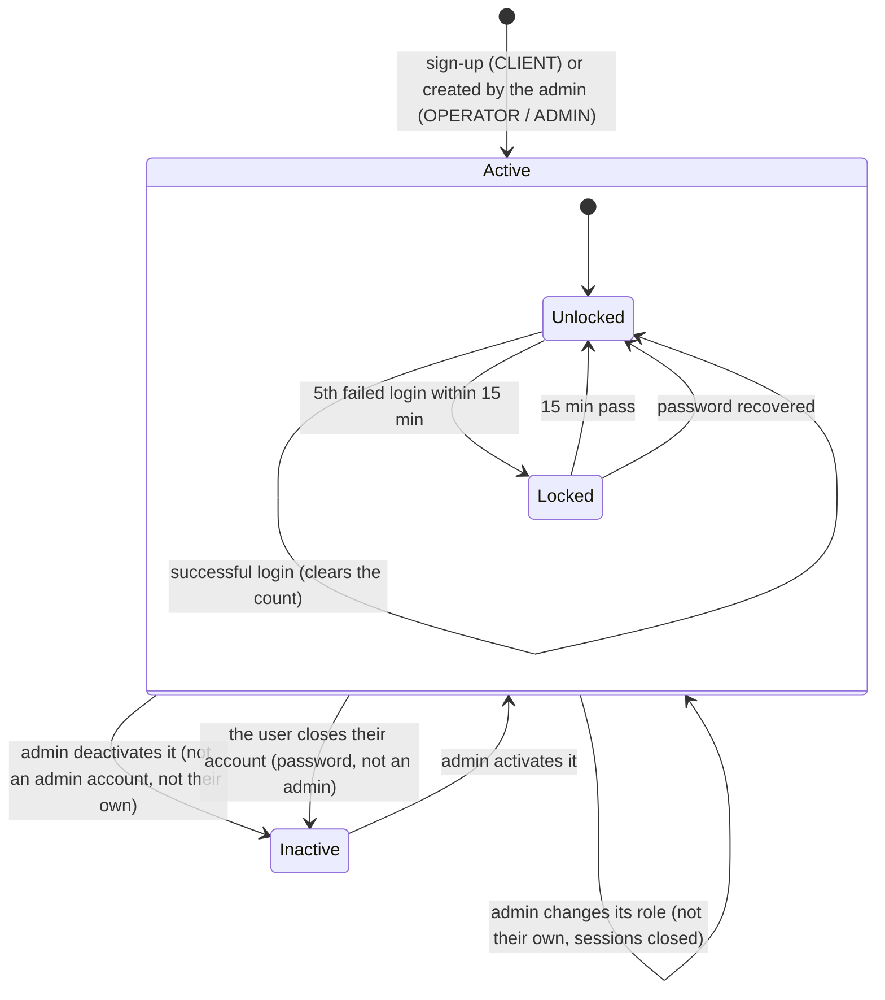

# State — User account (RF-001, RF-002, RF-004b, RF-027)

Source: `security-service` `UserAccount` (`activate`, `deactivate`, `ensureCanAuthenticate`),
`LoginLockout`, `AuthenticationService`, `UserAdministrationService.changeStatus`,
`UserAdministrationService.changeRole`, `AccountDeactivationService.deactivateOwnAccount`,
`PasswordRecoveryService.resetPassword`.
Checked on 2026-10-19.

| Rule | Where |
|---|---|
| While `Locked` even the right password answers 423 `ACCOUNT_LOCKED` | `AuthenticationService.login` |
| An `Inactive` account answers 403 `ACCOUNT_DISABLED`, checked only after the right password | `UserAccount.ensureCanAuthenticate` |
| An inactive account cannot ask for a recovery code (the answer looks the same) | `PasswordRecoveryService.findActiveAccount` |
| An admin cannot deactivate their own account, from the user list or from the profile → 403 `CANNOT_DISABLE_OWN_ACCOUNT` | `CannotDisableOwnAccountException` |
| No admin account can be deactivated; its role must be changed first → 403 `ADMIN_CANNOT_BE_DISABLED` | `AdminAccountCannotBeDisabledException` |
| An account has one role; the new one replaces the old one, the user must log in again, and nobody changes their own role → 403 `CANNOT_CHANGE_OWN_ROLE` | `UserAccount.changeRole`, `PATCH /api/v1/admin/users/{id}/role` |
| Closing one's own account asks for the current password and closes every session | `AccountDeactivationService` |
