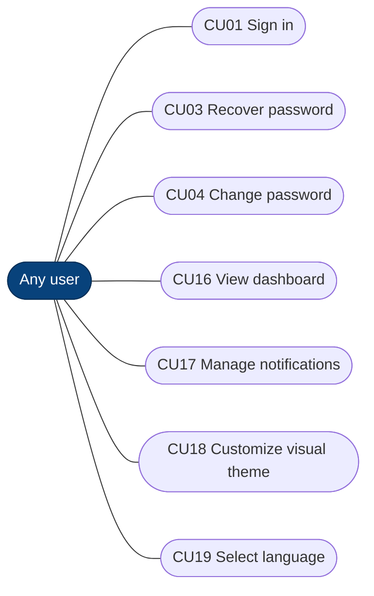
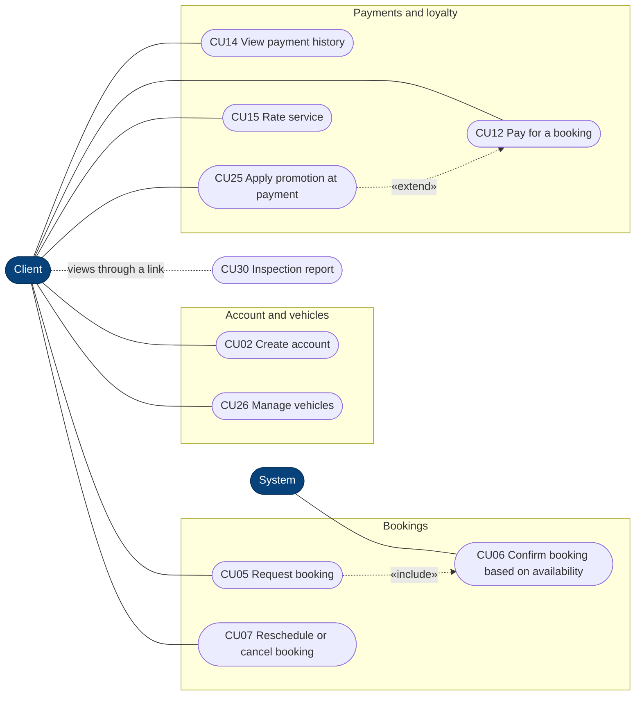
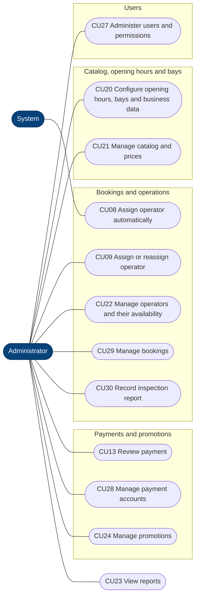
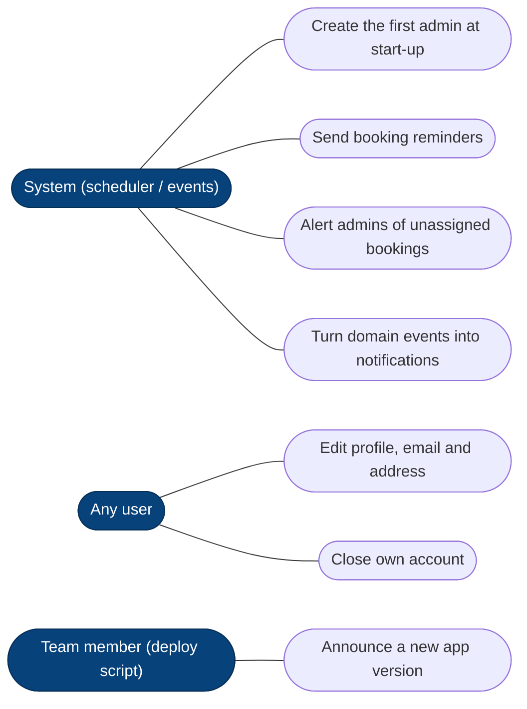

# Use cases by actor (CU01–CU30)

The same 30 use cases of the Requirements Specification (`lavarapido-docs`, SRS §7, Figures 3a–3d),
with the same numbers. Mermaid has no use case diagram, so actors and use cases are drawn as a
flowchart: rounded boxes are use cases, dotted arrows are `«include»` / `«extend»`. Which backend
input port implements each one: [uc-backend-mapping](./uc-backend-mapping.md). Checked on 2026-10-19.

## Any user (client, operator, admin)

## Client

## Operator

## Administrator and system

## Backend processes with no use case in the SRS

They run without a person asking for them, or they are account actions that the SRS groups under
other use cases. They are listed so the diagrams match the code; see the mapping for their ports.

