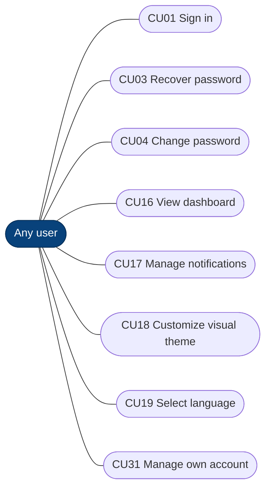
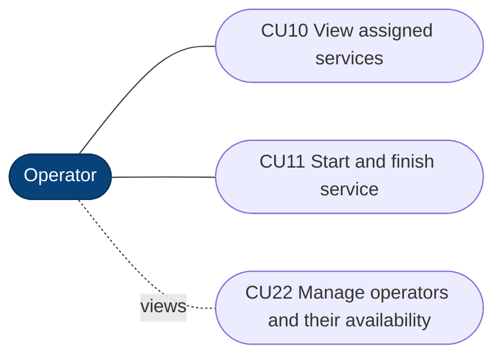
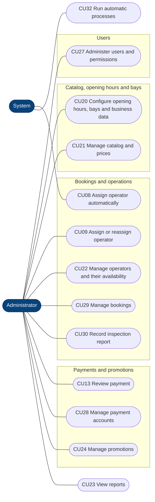
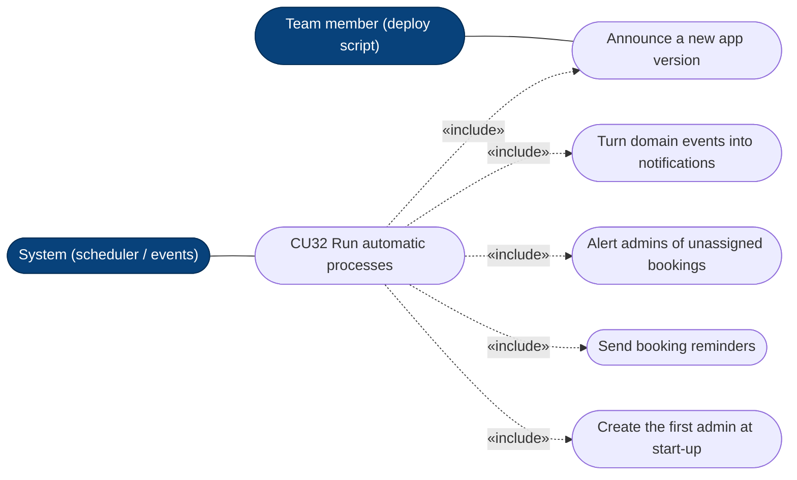

# Use cases by actor (CU01–CU32)

The same 32 use cases of the Requirements Specification (`lavarapido-docs`, SRS §7, Figures 3a–3d),
with the same numbers (CU31 and CU32 were added on 2026-10-19). Mermaid has no use case diagram, so actors and use cases are drawn as a
flowchart: rounded boxes are use cases, dotted arrows are `«include»` / `«extend»`. Which backend
input port implements each one: [uc-backend-mapping](./uc-backend-mapping.md). Checked on 2026-10-19.

## Any user (client, operator, admin)

## Client

## Operator

## Administrator and system

## What CU31 and CU32 group

CU31 is the user's own account (profile, address, email, sign out, close the account). CU32 groups
what runs without a person asking for it; the APK notice is started by a team member's script.

